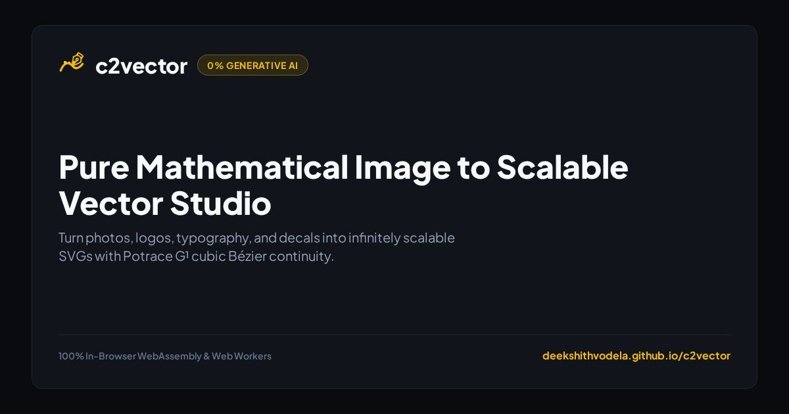
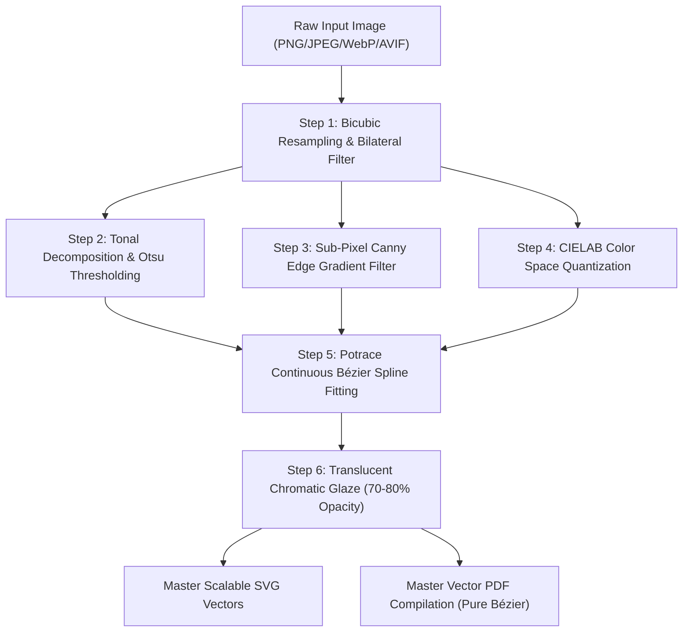

<div align="center">

# C2Vector Studio

**Deterministic In-Browser Vectorization & Scalable Vector Graphics Synthesis Engine**

[](LICENSE)
[](https://deekshithvodela.github.io/c2vector/about/)
[](https://deekshithvodela.github.io/c2vector/about/)
[](https://deekshithvodela.github.io/c2vector/about/)
[](https://deekshithvodela.github.io/c2vector/)
[](https://www.w3.org/TR/SVG11/)

[**Launch C2Vector Studio**](https://deekshithvodela.github.io/c2vector/) &bull; [**Algorithm Workflow**](https://deekshithvodela.github.io/c2vector/workflow/) &bull; [**About & FAQ**](https://deekshithvodela.github.io/c2vector/about/)

<br>

<p align="center">
  
</p>

</div>

---

## 🌟 Executive Summary

**C2Vector** is a high-precision, client-side vector synthesis application and Progressive Web App (PWA). It converts raster images (PNG, JPEG, WebP, AVIF), logos, camera photographs, and monograms into mathematically rigorous, infinitely scalable **W3C SVG 1.1 vectors** and master print-ready **vector PDF suites**—executing 100% inside your browser's native Web Workers.

### Why C2Vector?

Most online vectorizers suffer from one of three fatal flaws:
1. **Predatory Cloud Paywalls:** Forcing subscriptions or holding your high-resolution exports hostage.
2. **Cloud Privacy Leaks:** Uploading private company logos, sensitive intellectual property, or personal photos to opaque remote servers.
3. **Generative AI Hallucinations:** Wrapping uncalibrated diffusion or machine-learning models that distort straight lines into wavy noodles, smudge sharp corners, and invent phantom contours.

**C2Vector guarantees 0% Generative AI and 100% Mathematical Determinism.** Every vector curve, color plate, and boundary is calculated using peer-reviewed computer vision algorithms running entirely in local device memory.

---

## ✨ Key Features & Capabilities

### 1. 🛡️ 100% Client-Side Privacy & Zero Cloud Telemetry
- All processing occurs in dedicated browser **Web Workers** (`worker.js`).
- Images never travel across the network to any server, bucket, or third-party API.
- All in-memory buffers and ImageData representations are immediately reclaimed when the browser tab is closed.

### 2. 🔲 Dedicated Logo, Typography & Line-Art Engine (Default First Tab)
- **Logo Mode First & Default:** Opens directly into Logo & Typography Mode, with Photo / Decal Mode alongside it.
- **90-Degree Corner Preservation:** Tightened straight-line tolerance (`optTolerance: 0.08`) and aggressive corner retention (`alphaMax: 0.15`) ensure crisp right angles on corporate branding, sharp brackets, and geometric marks.
- **Dual-Pass Glyph & Stroke Optimization:** For hand-drawn line art and intricate illustrations, a two-pass Connected Component Labeling (Union-Find) mask calibrates stroke thickness within ±0.5% of master line weight while preserving compact micro-glyphs, handwriting, and fine dots with smooth $G^1$ cubic Bézier curves (`alphaMax: 0.72`, `optTolerance: 0.10`).
- **Alpha-Channel-Only Transparency & Prepress Trapping:** Preserves 100% of external and internal transparent cutouts (`alpha < 64`) without ever stripping white backgrounds from opaque images, while sealing adjacent color seams with 1px alpha-bounded trapping.
- **Vector Pro Studio (Logo & Photo Modes):** Live 0ms-latency SVG DOM layer tree grouped by color swatch (visibility eye toggle, solo isolation, live color picker, z-index reorder, delete, non-destructive reset), real-time Stroke Weight / Kerf bleed compensator (`0–8 px`), `0%` default Edge Glaze, and a color/tier budget slider (`2–32 Inks` / `2–48 Tiers`, smart `24`-tier Photo default with variance-stopping & CIELAB $\Delta E$ consolidation) with an explicit **Apply** button.
- **Glyph Detector & Anti-Wiggle Conditioning:** Connected-Component glyph separation with corner-safe anti-wiggle smoothing eliminates staircase ripples on curved/diagonal typography while lossless SVG path compaction trims ~15–20% of output size.

### 3. 🎨 Canva-Ready Master Artboard & Multi-Tonal Manufacturing Plates
Decomposes input graphics into production-ready manufacturing layers across **14 specialized artboards**:
- **Canva-Optimized Master (`canvaOptimized`):** Dedicated Master output in both Logo and Photo modes with **≤ 4 focal solid colors** (Max-Min $\Delta E$ × Chroma Focal Scoring + CIELAB pixel snapping so vivid accents like red eyes/stripes are preserved, leaving 1 color of headroom under Canva's 5-color swatch limit), zero translucent overlays, flat SVG 1.1 attributes, and hole-safe `evenodd` compound paths so Canva unlocks top-toolbar color swatches.
- **1-bit Otsu Monochrome Silhouette:** Variance minimization for pure high-contrast vinyl cutting.
- **2-Tone Duotone Print Plate:** Clean Key Dark & Midtone ink separation for screenprinting and editorial graphics.
- **4-Tone & 8-Tone Tonal Plates:** Progressive density plates calibrated via Tone Match Index (TMI).
- **Inverted Plates:** Negative print suites optimized for dark apparel printing and laser engraving.
- **Clean Cut Stencils:** Unblemished single-path silhouette stencil plates for plotters and laser cutters.

### 4. 📄 Master Scalable Vector PDF Suite & Dynamic Naming
- In-browser compilation using `jsPDF` and `svg2pdf.js`.
- Exports an Executive Cover Page plus all vector artboards into a single **14-page master PDF document** (`<source>_<mode>_master_suite_c2vector_DV.pdf`), with consistent dynamic filenames for individual SVGs and scaled PNGs (`@1x`, `@2x`, `@4x`).
- **100% Pure Vector Bézier Streams:** Infinite print scalability with strictly **0 raster compression artifacts**.

### 5. 🔍 Interactive 360° Native ViewBox Pan & Zoom Workbench
- **Crisp Native ViewBox Zoom (1x–8x):** Hardware-smooth pan, touch-drag, wheel zoom, soft boundary clamping, and dedicated **Center** control that preserves active magnification without GPU raster blur.
- **14 Specialized Artboards (4 Normalized Domains):** Organized cleanly into **Master** (Vibrant v2, Faithful, Canva Ready, Planar), **Screenprint** (Spot Color), **Tonal Studies** (1-Bit Mono, 2-Tone, 4T/8T Pos & Neg), and **Fabrication** (Cut Stencil, Hairline, Contours) with **strictly 0.00px Layout Shift (CLS)**.
- **Dynamic Swatch Palette:** Real-time hex color swatches with one-click clipboard copying and toast feedback.

### 6. 📱 Progressive Web App (PWA) & Build-Stamped Offline Cache
- **Network-First HTML + Build-Stamped Cache (`sw.js`):** Navigation requests use Network-First while content-hashed JS/CSS bundles use Cache-First, with automatic old-cache purging and stale cookie/session cleanup on new version rollouts.
- Installable as a standalone app on macOS, Windows, Linux, Android, and iOS.
- Multi-aspect ratio OpenGraph card suite (<100KB) and Google Search Central multiple-of-48px favicons.

---

## 🔬 Mathematical Architecture & Pipeline



1. **Step 1 — Resampling & Bilateral Edge-Preserving Smoothing:**
   High-order bicubic Hermite interpolation upscales input images to 4x resolution. A bilateral filter applies Gaussian spatial and photometric domain weighting:
   $$\text{BF}[I]_p = \frac{1}{W_p} \sum_{q \in S} G_{\sigma_s}(\|p - q\|) \, G_{\sigma_r}(|I_p - I_q|) \, I_q$$
2. **Step 2 — Tonal Studies & TMI Calibration:**
   Decomposes lightness into discrete tonal thresholds using Otsu's variance minimization and checks Tone Match Index ($TMI \ge 0.88$) for monotonic luminosity grading.
3. **Step 3 — Sub-Pixel Canny Edge Gradients:**
   Calculates horizontal and vertical Sobel gradients ($G_x, G_y$), detects local intensity maxima along gradient directions, and applies hysteresis thresholding ($T_{\text{low}}, T_{\text{high}}$) to generate 1-pixel hairline boundary contours.
4. **Step 4 — CIELAB Quantization:**
   Maps RGB pixels into perceptually uniform CIE $L^*a^*b^*$ color space. Computes Delta E differences ($\Delta E_{ab}^*$) to group anti-aliased transition pixels into distinct tonal plates without chromatic muddying.
5. **Step 5 — Schneider-Ramer-Peucker & Potrace Curve Tracing:**
   Traces boundary polygons, determines optimal knot vectors, and fits continuous cubic Bézier splines maintaining $G^1$ geometric continuity:
   $$\mathbf{B}(t) = (1-t)^3 \mathbf{P}_0 + 3(1-t)^2 t \mathbf{P}_1 + 3(1-t) t^2 \mathbf{P}_2 + t^3 \mathbf{P}_3, \quad t \in [0, 1]$$
6. **Step 6 — Multi-Page Vector PDF Export:**
   Compiles SVG vector streams into PDF drawing commands via Skia/PDF geometry primitives in local client memory.

---

## 📁 Repository Structure

```
c2vector/
├── public/                      # Static unbundled assets copied directly to dist/
│   ├── favicon.ico              # Standard root favicon
│   ├── manifest.webmanifest     # Progressive Web App manifest
│   ├── sw.js                    # Build-stamped Network-First/Cache-First Service Worker
│   ├── robots.txt               # Search crawler directives
│   ├── sitemap.xml              # Canonical clean XML sitemap
│   ├── .nojekyll                # GitHub Pages static asset bypass
│   ├── assets/
│   │   ├── icons/               # Favicon suite (48, 96, 192, 512, apple-touch)
│   │   ├── og/                  # Multi-aspect OpenGraph cards (<100KB)
│   │   ├── sample_logo.png      # Built-in demo logo graphic
│   │   └── sample_photo.png     # Built-in demo photography artwork
│   └── vendor/
│       ├── jspdf.umd.min.js     # Client-side PDF generator
│       └── svg2pdf.umd.min.js   # SVG-to-PDF geometry converter
├── scripts/
│   └── suite.mjs                # Unified automated verification, privacy audit & OG card CLI
├── src/
│   ├── css/
│   │   └── style.css            # Universal design system (Amber/Obsidian theme)
│   ├── js/
│   │   ├── app.js               # Application coordinator, UI events, native ViewBox pan-zoom
│   │   ├── engine/
│   │   │   ├── bezier-tracer.js # Continuous cubic Bézier SVG builders
│   │   │   ├── image-ops.js     # Bicubic resampling, bilateral denoise & Canny edge detection
│   │   │   ├── logo-engine.js   # Dedicated Logo, Typography & Line-Art vector engine
│   │   │   ├── pipeline.js      # Systematic 6-step photographic vector orchestration
│   │   │   ├── potrace.js       # Client-side Potrace curve & subpath fitting port
│   │   │   ├── quantizer.js     # CIELAB Delta E color science & median-cut quantization
│   │   │   ├── tonal-studies.js # Otsu 1-bit, exact alpha mask, stencil & dual-pass line art
│   │   │   └── worker.js        # Background Web Worker sandbox
│   │   └── export/
│   │       ├── pdf-builder.js   # 14-page pure vector PDF suite compiler
│   │       └── png-exporter.js  # OffscreenCanvas 1x/2x/4x PNG raster exporter
│   └── vendor/                  # Bundled engine vendor modules
├── index.html                   # Primary Studio Workbench application
├── about/
│   └── index.html               # Clean URL directory endpoint (/about/)
├── workflow/
│   └── index.html               # Clean URL directory endpoint (/workflow/)
├── vite.config.js               # Vite multi-page build configuration
├── package.json                 # Project manifest & npm scripts
├── README.md                    # Repository documentation
├── CONTRIBUTING.md              # Contribution guidelines & code quality standards
├── LICENSE                      # Official MIT License
└── SECURITY.md                  # Security and vulnerability policy
```

---

## 🚀 Quickstart & Local Development

### 1. Clone the Repository
```bash
git clone https://github.com/deekshithvodela/c2vector.git
cd c2vector
```

### 2. Install Dependencies & Start Dev Server
```bash
npm install
npm run dev
```

Open your browser at `http://localhost:5173/c2vector/`.

### 3. Build for Production
```bash
npm run build
npm run preview
```

### 4. Run Automated Quality & Verification Suites
```bash
# Run the complete automated test & verification suite:
npm test
# (or: node scripts/suite.mjs)

# Generate luxury OpenGraph social preview card suite:
npm run generate:og
# (or: node scripts/suite.mjs --og)
```

---

## 🌐 GitHub Pages Deployment Guide

To deploy the production-ready Progressive Web App to GitHub Pages (`https://deekshithvodela.github.io/c2vector/`):

1. **Dedicated Repository (Recommended):**
   ```bash
   cd c2vector
   git init
   git add .
   git commit -m "feat: release c2vector production suite"
   git branch -M main
   git remote add origin https://github.com/deekshithvodela/c2vector.git
   git push -u origin main
   ```
2. In GitHub repository **Settings** $\to$ **Pages**, set:
   - **Source:** `Deploy from a branch`
   - **Branch:** `main` / `/ (root)`
3. The site will be instantly live at `https://deekshithvodela.github.io/c2vector/`.

---

## 📊 Quality & Production Standards (ISO/IEC 25010)

- **Functional Correctness:** 41 / 41 high-signal composite automated Playwright, geometry, transparency, and privacy tests passing (`npm test`).
- **7-Vector Privacy & Leak Hygiene:** Verified 0 exposed local developer paths, 0 internal agent metadata paths, 0 private IPs, 0 hardcoded secrets, and 0 unstripped sourcemaps across both `src/` and compiled `dist/`.
- **Accessibility (WCAG 2.2 Level AA):** High-contrast ratios ($\ge 4.5:1$), complete keyboard navigation, explicit `type="button"` on all interactive buttons, `aria-hidden` decorative SVGs, and `prefers-reduced-motion` support.
- **Performance:** Sub-second First Contentful Paint (FCP), hoisted early font preconnects, Web Worker offloaded CPU tasks, and 60fps native ViewBox pan/zoom.
- **Security:** Zero runtime npm dependencies, zero DOM XSS vectors (`eval()` / `new Function()`), explicit HTTPS protocols, `rel="noopener noreferrer"` on all external links, and character entity encoded contact emails.
- **Clean URLs:** Universal directory routing (`/`, `/about/`, `/workflow/`) without `.html` extensions.

---

## 👤 Author & Credits

Designed and engineered with mathematical determinism by **Deekshith Vodela**.

- **Website:** [https://deekshithvodela.github.io/c2vector/](https://deekshithvodela.github.io/c2vector/)
- **LinkedIn:** [Deekshith Vodela](https://www.linkedin.com/in/deekshithvodela/)
- **Newsletter:** [Substack](https://deekshithvodela.substack.com/)
- **GitHub:** [@deekshithvodela](https://github.com/deekshithvodela)

---

## 📄 License

This project is licensed under the **MIT License**. See the [LICENSE](LICENSE) file for details.

```
Copyright (c) 2026 Deekshith Vodela
```
