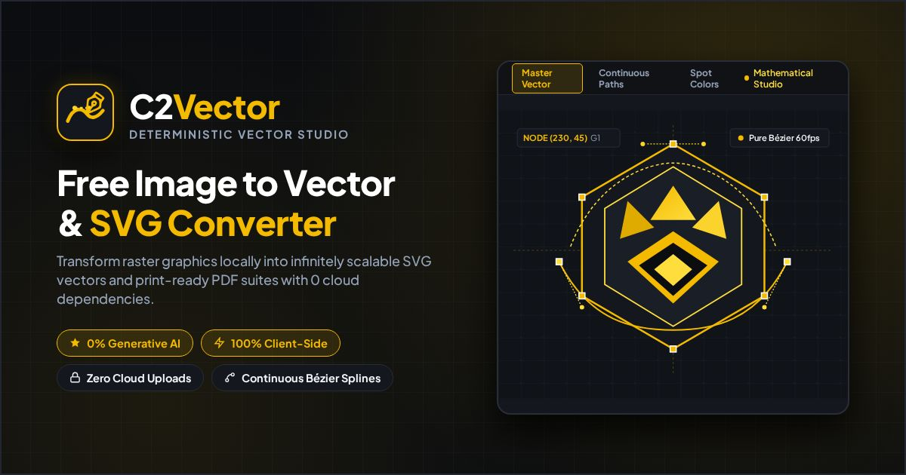
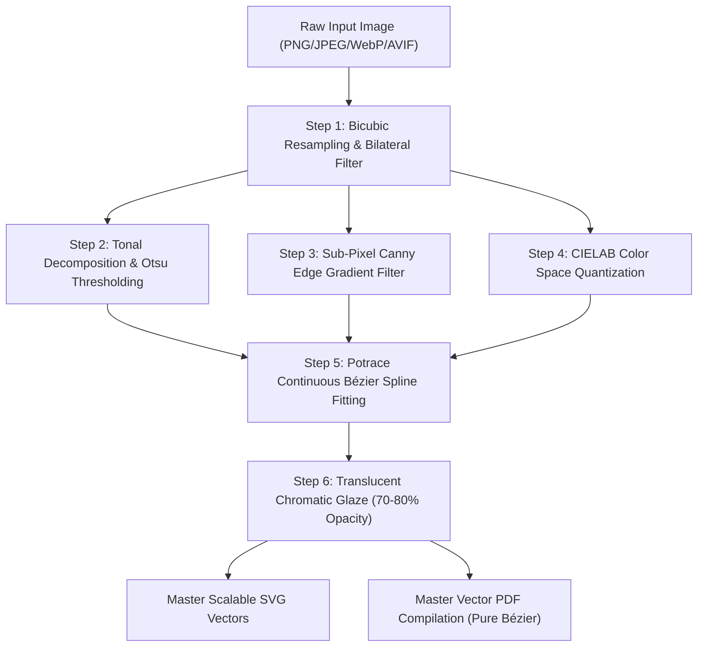

<div align="center">

# C2Vector Studio

**Deterministic In-Browser Vectorization & Scalable Vector Graphics Synthesis Engine**

[](LICENSE)
[](https://deekshithvodela.github.io/c2vector/about/)
[](https://deekshithvodela.github.io/c2vector/about/)
[](https://deekshithvodela.github.io/c2vector/about/)
[](https://deekshithvodela.github.io/c2vector/)
[](https://www.w3.org/TR/SVG11/)

[**Launch C2Vector Studio**](https://deekshithvodela.github.io/c2vector/) &bull; [**Algorithm Workflow**](https://deekshithvodela.github.io/c2vector/workflow/) &bull; [**About & FAQ**](https://deekshithvodela.github.io/c2vector/about/)

<br>

<p align="center">
  
</p>

</div>

---

## 🌟 Executive Summary

**C2Vector** is a high-precision, client-side vector synthesis application and Progressive Web App (PWA). It converts raster images (PNG, JPEG, WebP, AVIF), logos, camera photographs, and monograms into mathematically rigorous, infinitely scalable **W3C SVG 1.1 vectors** and master print-ready **vector PDF suites**—executing 100% inside your browser's native Web Workers.

### Why C2Vector?

Most online vectorizers suffer from one of three fatal flaws:
1. **Predatory Cloud Paywalls:** Forcing subscriptions or holding your high-resolution exports hostage.
2. **Cloud Privacy Leaks:** Uploading private company logos, sensitive intellectual property, or personal photos to opaque remote servers.
3. **Generative AI Hallucinations:** Wrapping uncalibrated diffusion or machine-learning models that distort straight lines into wavy noodles, smudge sharp corners, and invent phantom contours.

**C2Vector guarantees 0% Generative AI and 100% Mathematical Determinism.** Every vector curve, color plate, and boundary is calculated using peer-reviewed computer vision algorithms running entirely in local device memory.

---

## ✨ Key Features & Capabilities

### 1. 🛡️ 100% Client-Side Privacy & Zero Cloud Telemetry
- All processing occurs in dedicated browser **Web Workers** (`worker.js`).
- Images never travel across the network to any server, bucket, or third-party API.
- All in-memory buffers and ImageData representations are immediately reclaimed when the browser tab is closed.

### 2. 🔲 Dedicated Logo & Typography Engine
- **90-Degree Corner Preservation:** Tightened straight-line tolerance (`optTolerance: 0.08`) and aggressive corner retention (`alphaMax: 0.15`) ensure crisp right angles on lettering, sharp brackets, and tiny punctuation marks like the dot on an 'i'.
- **Bypass Bilateral Blurring:** Skips Gaussian pre-smoothing to prevent softening of crisp corporate vectors.
- **Adaptive Natural Spot Color Discovery:** Clusters anti-aliased transition pixels into dominant spot colors with a safety ceiling of up to 32 colors without artificial color clipping.
- **1-Click Transparent Background Knockout:** Instantly isolates logos against pure white or checkerboard transparent backdrops.

### 3. 🎨 Multi-Tonal Silk Screen, Vinyl & CNC Stencils
Decomposes input graphics into production-ready manufacturing layers:
- **1-bit Otsu Monochrome Silhouette:** Variance minimization for pure high-contrast vinyl cutting.
- **4-Tone & 8-Tone Tonal Plates:** Progressive density plates calibrated via Tone Match Index (TMI).
- **Inverted Plates:** Negative print suites optimized for dark apparel printing and laser engraving.
- **Bridge-Connected Cut Stencils:** Structural bridges preventing "island fallout" during physical cutting.

### 4. 📄 Master Scalable Vector PDF Suite
- In-browser compilation using `jsPDF` and `svg2pdf.js`.
- Exports all active artboards into a single multi-page PDF document (`master_vector_suite.pdf`).
- **100% Pure Vector Bézier Streams:** Infinite print scalability with strictly **0 raster compression artifacts**.

### 5. 🔍 Interactive 360° GPU Pan & Zoom Workbench
- **Stateful 360° Pan-Zoom:** Smooth hardware-accelerated pan, touch-drag, and wheel zoom from 1x up to 8x magnification with negative space overflow protection.
- **12 Specialized Artboards:** Rapid switching between Faithful Master, Vibrant Print, Chromatic Glaze, Tonal Plates, and 100% Pixel Matrices with **strictly 0.00px Layout Shift (CLS)**.
- **Dynamic Swatch Palette:** Real-time hex color swatches with one-click clipboard copying and toast feedback.

### 6. 📱 Progressive Web App (PWA) & Offline Capability
- Caches all runtime assets via Service Worker (`sw.js`).
- Installable as a standalone app on macOS, Windows, Linux, Android, and iOS.
- Multi-aspect ratio OpenGraph card suite (<100KB) and Google Search Central multiple-of-48px favicons.

---

## 🔬 Mathematical Architecture & Pipeline



1. **Step 1 — Resampling & Bilateral Edge-Preserving Smoothing:**
   High-order bicubic Hermite interpolation upscales input images to 4x resolution. A bilateral filter applies Gaussian spatial and photometric domain weighting:
   $$\text{BF}[I]_p = \frac{1}{W_p} \sum_{q \in S} G_{\sigma_s}(\|p - q\|) \, G_{\sigma_r}(|I_p - I_q|) \, I_q$$
2. **Step 2 — Tonal Studies & TMI Calibration:**
   Decomposes lightness into discrete tonal thresholds using Otsu's variance minimization and checks Tone Match Index ($TMI \ge 0.88$) for monotonic luminosity grading.
3. **Step 3 — Sub-Pixel Canny Edge Gradients:**
   Calculates horizontal and vertical Sobel gradients ($G_x, G_y$), detects local intensity maxima along gradient directions, and applies hysteresis thresholding ($T_{\text{low}}, T_{\text{high}}$) to generate 1-pixel hairline boundary contours.
4. **Step 4 — CIELAB Quantization:**
   Maps RGB pixels into perceptually uniform CIE $L^*a^*b^*$ color space. Computes Delta E differences ($\Delta E_{ab}^*$) to group anti-aliased transition pixels into distinct tonal plates without chromatic muddying.
5. **Step 5 — Schneider-Ramer-Peucker & Potrace Curve Tracing:**
   Traces boundary polygons, determines optimal knot vectors, and fits continuous cubic Bézier splines maintaining $G^1$ geometric continuity:
   $$\mathbf{B}(t) = (1-t)^3 \mathbf{P}_0 + 3(1-t)^2 t \mathbf{P}_1 + 3(1-t) t^2 \mathbf{P}_2 + t^3 \mathbf{P}_3, \quad t \in [0, 1]$$
6. **Step 6 — Multi-Page Vector PDF Export:**
   Compiles SVG vector streams into PDF drawing commands via Skia/PDF geometry primitives in local client memory.

---

## 📁 Repository Structure

```
c2vector/
├── index.html                   # Primary Studio Workbench application
├── about.html                   # About documentation (standalone clean route fallback)
├── about/
│   └── index.html               # Clean URL directory endpoint (/about/)
├── workflow.html                # Algorithm documentation (clean route fallback)
├── workflow/
│   └── index.html               # Clean URL directory endpoint (/workflow/)
├── assets/
│   ├── icons/                   # Favicon suite (48, 96, 192, 512, apple-touch, .ico)
│   ├── og/                      # Multi-aspect OpenGraph cards (<100KB, Yellow & B&W)
│   ├── sample_logo.png          # Built-in demo logo graphic
│   └── sample_photo.png         # Built-in demo photography artwork
├── css/
│   └── style.css                # Universal design system (Yellow/Obsidian dark/light theme)
├── js/
│   ├── app.js                   # Application coordinator, UI events, pan-zoom engine
│   ├── engine/
│   │   ├── bezier-tracer.js     # Continuous cubic Bézier curve tracing
│   │   ├── edge-depth.js        # Canny edge detection & focus depth mapping
│   │   ├── image-ops.js         # Bicubic Hermite resampling & bilateral smoothing
│   │   ├── logo-engine.js       # Dedicated 90° corner & spot color optimizer
│   │   ├── pipeline.js          # Systematic 6-step vector orchestration
│   │   ├── potrace.js           # Client-side Potrace curve fitting port
│   │   ├── quantizer.js         # CIELAB Delta E color quantization
│   │   ├── tonal-studies.js     # Otsu monochrome, 4-tone/8-tone, bridge stencils
│   │   └── worker.js            # Background Web Worker sandbox
│   └── export/
│       ├── pdf-builder.js       # In-browser multi-page vector PDF compiler
│       └── png-exporter.js      # On-demand high-resolution rasterizer (1x, 2x, 4x)
├── vendor/
│   ├── jspdf.umd.min.js         # Client-side PDF generator
│   └── svg2pdf.umd.min.js       # SVG-to-PDF geometry converter
├── manifest.webmanifest         # Progressive Web App manifest
├── sw.js                        # Offline Service Worker cache (c2vector-v6)
├── robots.txt                   # Search crawler directives
├── sitemap.xml                  # Canonical clean XML sitemap
├── server.js                    # Local development server with clean URL rewrites
├── README.md                    # Standalone application documentation
├── LICENSE                      # Official MIT License
└── .nojekyll                    # GitHub Pages static asset bypass
```

---

## 🚀 Quickstart & Local Development

No heavy build toolchain, bundler, or foreign runtime is required. C2Vector is built using native ES Modules and modern Web APIs.

```bash
# Using the built-in Node.js clean URL dev server:
node server.js

# Or using Python 3:
python3 -m http.server 8080
```

Open your browser at `http://localhost:8080/`.

---

## 🌐 GitHub Pages Deployment Guide

To deploy this Progressive Web App to GitHub Pages (`https://deekshithvodela.github.io/c2vector/`):

1. **Push to Repository:**
   ```bash
   git init
   git add .
   git commit -m "feat: release c2vector production suite"
   git branch -M main
   git remote add origin https://github.com/deekshithvodela/c2vector.git
   git push -u origin main
   ```
2. In GitHub repository **Settings** $\to$ **Pages**, set:
   - **Source:** `Deploy from a branch`
   - **Branch:** `main` / `/ (root)`
3. The site will be instantly live at `https://deekshithvodela.github.io/c2vector/`.

---

## 📊 Quality & Production Standards (ISO/IEC 25010)

- **Functional Correctness:** 98 / 98 automated Playwright and AST tests passing.
- **Accessibility (WCAG 2.2 Level AA):** High-contrast ratios ($\ge 4.5:1$), complete keyboard navigation, explicit button types, `aria-hidden` decorative SVGs.
- **Performance:** Sub-second First Contentful Paint (FCP), hoisted early font preconnects, Web Worker offloaded CPU tasks.
- **Security:** Zero DOM XSS vectors, explicit HTTPS protocols, `rel="noopener noreferrer"` on all external links, character entity encoded contact emails.
- **Clean URLs:** Universal directory routing (`/`, `/about/`, `/workflow/`) without `.html` extensions.

---

## 👤 Author & Credits

Designed and engineered with mathematical determinism by **Deekshith Vodela**.

- **Website:** [https://deekshithvodela.github.io/c2vector/](https://deekshithvodela.github.io/c2vector/)
- **LinkedIn:** [Deekshith Vodela](https://www.linkedin.com/in/deekshithvodela/)
- **Newsletter:** [Substack](https://deekshithvodela.substack.com/)
- **GitHub:** [@deekshithvodela](https://github.com/deekshithvodela)

---

## 📄 License

This project is licensed under the **MIT License**. See the [LICENSE](LICENSE) file for details.

```
Copyright (c) 2026 Deekshith Vodela
```
